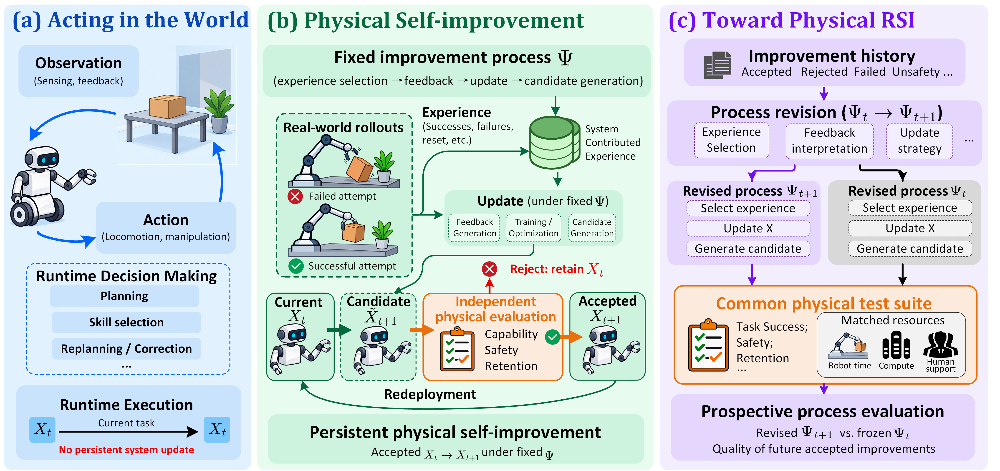

# Awesome Physical RSI

**From Self-Improvement to Recursive Self-Improvement in Physical AI: A Survey**

   

A companion reading list on how embodied systems acquire experience, construct feedback, and retain improvements to policies, memories, predictive models, and learning procedures. The catalog follows the survey's functional taxonomy and includes its foundational and digital precedents.

**Physical self-improvement (SI)** retains improvements to an embodied system. **Recursive self-improvement (RSI)** uses earlier improvement outcomes to revise the process that produces later gains. The survey proposes evaluating a revised process against its saved predecessor through subsequent learning under matched conditions and resources.

## Updates

- **2026-10-13** — Catalog: **214 / 214** manuscript citations indexed, **214** paper links, and **178** papers with linked resources (**149** with code).

## Contents

- [How to read the catalog](#how-to-read-the-catalog)
- [Paper catalog](#paper-catalog)
  - [1. Surveys and foundations](#1-surveys-and-foundations)
    - [Related surveys and perspectives (10)](#related-surveys-and-perspectives)
    - [Meta-learning and learned optimization (4)](#meta-learning-and-learned-optimization)
    - [Continual learning and capability retention (6)](#continual-learning-and-capability-retention)
    - [Curricula, self-play, and environment design (7)](#curricula-self-play-and-environment-design)
    - [Digital self-improvement and agent design (8)](#digital-self-improvement-and-agent-design)
  - [2. Embodied starting points](#2-embodied-starting-points)
    - [Generalist policies and action models (8)](#generalist-policies-and-action-models)
    - [Language-guided planning and executable skills (5)](#language-guided-planning-and-executable-skills)
  - [3. Experience acquisition](#3-experience-acquisition)
    - [Robot datasets, demonstrations, and collection tools (21)](#robot-datasets-demonstrations-and-collection-tools)
    - [Autonomous practice, recovery, and deployment loops (18)](#autonomous-practice-recovery-and-deployment-loops)
    - [Simulation, synthetic experience, and transfer (17)](#simulation-synthetic-experience-and-transfer)
  - [4. Feedback and verification](#4-feedback-and-verification)
    - [Rewards, progress, failure diagnosis, and verification (16)](#rewards-progress-failure-diagnosis-and-verification)
  - [5. Persistent updates and process revision](#5-persistent-updates-and-process-revision)
    - [Policy improvement and adaptation (21)](#policy-improvement-and-adaptation)
    - [World models and physical self-models (13)](#world-models-and-physical-self-models)
    - [Improvement-process design and revision (13)](#improvement-process-design-and-revision)
  - [6. Resources and evaluation](#6-resources-and-evaluation)
    - [Benchmarks and evaluation protocols (25)](#benchmarks-and-evaluation-protocols)
  - [7. Safety and trustworthy improvement](#7-safety-and-trustworthy-improvement)
    - [Safety, constraints, alignment, and risk (22)](#safety-constraints-alignment-and-risk)
- [Contributing](#contributing)
- [Citation](#citation)
- [Acknowledgments](#acknowledgments)

## How to read the catalog

- Each paper appears once under its primary contribution. Many papers support several functions; section-level cross-references are retained in the [machine-readable catalog](data/papers.json).
- **Paper titles** link to an original paper, publisher page, or author-hosted manuscript. **Code**, **Project**, **Data**, and **Models** link to associated resources supported by a source record. A code link does not imply that experiments have been reproduced.
- **—** means that no associated resource link has been verified in this catalog. It does not mean that code or data is unavailable.
- Publication labels come from the manuscript bibliography unless a primary source has been checked. **arXiv preprint** describes the version indexed here; it is not a claim about all later publication history. Link evidence and any metadata questions are recorded with each entry.
- Inclusion records relevance to the survey. Digital agents, simulated methods, datasets, and runtime planners have distinct roles in this literature; inclusion alone does not establish physical RSI.

## Paper catalog

## 1. Surveys and foundations

### Related surveys and perspectives

Surveys that place physical improvement in the wider agent, robotics, and foundation-model literature.

| Paper | Year · venue / version | Focus | Resources |
|:---|:---|:---|:---|
| [**A survey of self-evolving agents: What, when, how, and where to evolve on the path to artificial super intelligence**](https://arxiv.org/abs/2507.21046) | TMLR 2026 | Taxonomy of agent evolution targets, timing, mechanisms, and deployment settings | [Companion repository](https://github.com/CharlesQ9/Self-Evolving-Agents) |
| [**A survey on vision--language--action models for embodied ai**](https://arxiv.org/abs/2405.14093) | IEEE TNNLS 2026 | Reviewing vision-language-action architectures and embodied artificial intelligence capabilities | [Survey companion](https://github.com/yueen-ma/Awesome-VLA) |
| [**Foundation models in robotics: A comprehensive review of methods, models, datasets, challenges and future research directions**](https://arxiv.org/abs/2604.15395) | 2026 · arXiv preprint | Reviewing robotics foundation models, resources, limitations, and research directions | — |
| [**Recursive Self-Improvement in AI: From Bounded Self-Refinement to Autonomous Research Loops**](https://arxiv.org/abs/2607.07663) | 2026 · arXiv preprint | Surveying committed self-modifications, evaluator hierarchies, and autonomous research loops | — |
| [**Self-Improvements in Modern Agentic Systems: A Survey**](https://arxiv.org/abs/2607.13104) | 2026 · arXiv preprint | Surveying self-induced model and scaffold changes in agentic systems | [Survey companion](https://github.com/selfimproving-agent/awesome-Self-Improving-Agents) · [Project](https://selfimproving-agent.github.io/) |
| [**The Last AI Built by Humans: Toward Genuine Recursive Self-Improvement**](https://arxiv.org/abs/2609.11873) | 2026 · arXiv preprint | Mapping increasing autonomy across execution, strategy, and recursive improvement | — |
| [**Toward Unified Robot Learning: Bridging Representation, Vision-Language-Action, and World Models**](https://arxiv.org/abs/2609.03927) | 2026 · arXiv preprint | Connecting representations, action models, and world models in robot learning | — |
| [**Vision-Language-Action in Robotics: A Survey of Datasets, Benchmarks, and Data Engines**](https://arxiv.org/abs/2604.23001) | 2026 · arXiv preprint | Organizing robotics action-model datasets, benchmarks, and data generation engines | — |
| [**On The Statistical Limits of Self-Improving Agents**](https://arxiv.org/abs/2510.04399) | 2025 · arXiv preprint | Statistical conditions and limits for sustained improvement from self-generated feedback | — |
| [**Understanding world or predicting future? a comprehensive survey of world models**](https://arxiv.org/abs/2411.14499) | ACM Computing Surveys 2025 | Surveying world models for representation learning and future prediction | [Survey companion](https://github.com/tsinghua-fib-lab/World-Model) |

[↑ Contents](#contents)

### Meta-learning and learned optimization

Learning reusable adaptation rules, optimizers, and priors for later tasks.

| Paper | Year · venue / version | Focus | Resources |
|:---|:---|:---|:---|
| [**Learning to learn without gradient descent by gradient descent**](https://arxiv.org/abs/1611.03824) | 2017 · ICML | Learning recurrent optimization strategies without requiring objective gradients | — |
| [**Model-agnostic meta-learning for fast adaptation of deep networks**](https://arxiv.org/abs/1703.03400) | 2017 · ICML | Learning parameter initializations that adapt rapidly from limited task data | [Code](https://github.com/cbfinn/maml) |
| [**One-shot visual imitation learning via meta-learning**](https://proceedings.mlr.press/v78/finn17a.html) | CoRL 2017 | Learning adaptation priors for one-shot visual robot imitation | [Code](https://github.com/tianheyu927/mil) · [Project](https://sites.google.com/view/one-shot-imitation) |
| [**Learning to learn by gradient descent by gradient descent**](https://arxiv.org/abs/1606.04474) | 2016 · NeurIPS | Learning recurrent optimizers that produce gradient-informed parameter updates | [Code](https://github.com/google-deepmind/learning-to-learn) |

[↑ Contents](#contents)

### Continual learning and capability retention

Retaining earlier capabilities while learning from new tasks and experience.

| Paper | Year · venue / version | Focus | Resources |
|:---|:---|:---|:---|
| [**Actions as language: Fine-tuning vlms into vlas without catastrophic forgetting**](https://arxiv.org/abs/2509.22195) | ICLR 2026 | Action token training that preserves pretrained vision language capabilities | [Code](https://github.com/irom-princeton/vlm2vla) · [Project](https://vlm2vla.github.io/) |
| [**Towards long-lived robots: Continual learning vla models via reinforcement fine-tuning**](https://arxiv.org/abs/2602.10503) | RSS 2026 | Continual VLA reinforcement fine tuning while retaining earlier robot skills | [Project](https://yuan-liu-lifelong-rft.github.io/) |
| [**Continual Robot Learning via Language-Guided Skill Acquisition**](https://openreview.net/forum?id=dVMqrppXOR) | 2025 · TMLR | Continually acquiring reusable robot skills through language guided learning | [Project](https://sites.google.com/view/continuallearning) |
| [**Experience replay for continual learning**](https://arxiv.org/abs/1811.11682) | 2019 · NeurIPS | Combining replay and current experience to preserve capabilities during continued learning | — |
| [**Gradient episodic memory for continual learning**](https://arxiv.org/abs/1706.08840) | 2017 · NeurIPS | Constraining new gradients with episodic memories to retain earlier tasks | [Code](https://github.com/facebookresearch/GradientEpisodicMemory) |
| [**Overcoming catastrophic forgetting in neural networks**](https://arxiv.org/abs/1612.00796) | 2017 · Proceedings of the national academy of sciences | Regularizing parameters important to earlier tasks to reduce catastrophic forgetting | — |

[↑ Contents](#contents)

### Curricula, self-play, and environment design

Selecting or generating learning opportunities with changing difficulty and coverage.

| Paper | Year · venue / version | Focus | Resources |
|:---|:---|:---|:---|
| [**Self-Evolving Learning for Embodied AI with Criticality Model**](https://arxiv.org/abs/2607.28251) | 2026 · arXiv preprint | Prioritizing failure prone states through learned criticality estimates | — |
| [**Prioritized level replay**](https://arxiv.org/abs/2010.03934) | 2021 · ICML | Replaying learning opportunities according to estimated agent learning potential | [Code](https://github.com/facebookresearch/level-replay) |
| [**Emergent complexity and zero-shot transfer via unsupervised environment design**](https://arxiv.org/abs/2012.02096) | 2020 · NeurIPS | Adversarially generating environments that produce emergent challenges and transfer | — |
| [**Emergent tool use from multi-agent autocurricula**](https://arxiv.org/abs/1909.07528) | 2019 · arXiv preprint | Emerging tool-use behavior through competing agents and changing self-play curricula | [Environment generation code](https://github.com/openai/multi-agent-emergence-environments) |
| [**Automatic goal generation for reinforcement learning agents**](https://arxiv.org/abs/1705.06366) | 2018 · ICML | Generating goals of appropriate difficulty using adversarial training | [Code](https://github.com/florensacc/rllab-curriculum) |
| [**Intrinsic motivation and automatic curricula via asymmetric self-play**](https://arxiv.org/abs/1703.05407) | 2017 · arXiv preprint | Producing adaptive task curricula through asymmetric self-play | — |
| [**Curriculum learning**](https://ronan.collobert.com/pub/2009_curriculum_icml.pdf) | 2009 · ICML | Ordering training examples by difficulty to improve optimization and generalization | — |

[↑ Contents](#contents)

### Digital self-improvement and agent design

Language-agent refinement, tool feedback, and editable improvement procedures that inform the physical setting.

| Paper | Year · venue / version | Focus | Resources |
|:---|:---|:---|:---|
| [**Self-adapting language models**](https://arxiv.org/abs/2506.10943) | 2026 · NeurIPS | Learning self-editing data and update directives for language-model adaptation | [Code](https://github.com/Continual-Intelligence/SEAL) · [Project](https://jyopari.github.io/posts/seal) |
| [**Critic: Large language models can self-correct with tool-interactive critiquing**](https://arxiv.org/abs/2305.11738) | 2024 · ICLR | Correcting language-model outputs through external tools and interactive critique | [Code](https://github.com/microsoft/ProphetNet/tree/master/CRITIC) |
| [**On-policy distillation of language models: Learning from self-generated mistakes**](https://arxiv.org/abs/2306.13649) | 2024 · ICLR | Distilling language models with feedback on their own generated responses | — |
| [**Self-rewarding language models**](https://arxiv.org/abs/2401.10020) | 2024 · arXiv preprint | Iteratively training language models using rewards supplied by language models themselves | — |
| [**Reflexion: Language agents with verbal reinforcement learning**](https://arxiv.org/abs/2303.11366) | 2023 · NeurIPS | Retaining verbal reflections from task feedback to guide later attempts | [Code](https://github.com/noahshinn/reflexion) |
| [**Self-refine: Iterative refinement with self-feedback**](https://arxiv.org/abs/2303.17651) | 2023 · NeurIPS | Iteratively improving generated answers through model-produced feedback and revision | [Code](https://github.com/madaan/self-refine) |
| [**Voyager: An open-ended embodied agent with large language models**](https://arxiv.org/abs/2305.16291) | 2023 · arXiv preprint | Expanding an executable skill library through open-ended Minecraft exploration | [Code](https://github.com/MineDojo/Voyager) · [Project](https://voyager.minedojo.org/) |
| [**Star: Bootstrapping reasoning with reasoning**](https://arxiv.org/abs/2203.14465) | 2022 · NeurIPS | Bootstrapping reasoning capabilities by training on generated and corrected rationales | [Code](https://github.com/ezelikman/STaR) |

[↑ Contents](#contents)

## 2. Embodied starting points

### Generalist policies and action models

Reusable robot policies, vision-language-action models, and action representations.

| Paper | Year · venue / version | Focus | Resources |
|:---|:---|:---|:---|
| [**Diffusion policy: Visuomotor policy learning via action diffusion**](https://arxiv.org/abs/2303.04137) | 2025 · IJRR | Generating visuomotor action sequences through conditional diffusion | [Code](https://github.com/real-stanford/diffusion_policy) |
| [**Generalist robot manipulation beyond action labeled data**](https://arxiv.org/abs/2509.19958) | CoRL 2025 | Training generalist manipulation policies using data without action annotations | [Code](https://github.com/insait-institute/motovla) · [Project](https://motovla.insait.ai/) |
| [**3d diffusion policy: Generalizable visuomotor policy learning via simple 3d representations**](https://arxiv.org/abs/2403.03954) | 2024 · arXiv preprint | Diffusion policies using compact point cloud representations for generalization | [Code](https://github.com/YanjieZe/3D-Diffusion-Policy) · [Project](https://3d-diffusion-policy.github.io/) · [Data](https://1drv.ms/u/s!Ag5QsBIFtRnTlFWqYWtS2wMMPKNX?e=dw8hsS) |
| [**Octo: An open-source generalist robot policy**](https://arxiv.org/abs/2405.12213) | 2024 · arXiv preprint | Generalist robot policy pretraining with flexible observations and action interfaces | [Code](https://github.com/octo-models/octo) · [Project](https://octo-models.github.io/) · [Octo Base 1.5](https://huggingface.co/rail-berkeley/octo-base-1.5) |
| [**Openvla: An open-source vision-language-action model**](https://arxiv.org/abs/2406.09246) | 2024 · arXiv preprint | Open vision-language-action model pretraining and adaptation for robot manipulation | [Code](https://github.com/openvla/openvla) · [OpenVLA 7B](https://huggingface.co/openvla/openvla-7b) |
| [**Rt-2: Vision-language-action models transfer web knowledge to robotic control**](https://arxiv.org/abs/2307.15818) | 2023 · arXiv preprint | Transferring web-trained visual and linguistic knowledge into robot actions | — |
| [**R3m: A universal visual representation for robot manipulation**](https://arxiv.org/abs/2203.12601) | 2022 · arXiv preprint | Reusable visual representations pretrained from diverse human interaction video | [Code](https://github.com/facebookresearch/r3m) |
| [**Rt-1: Robotics transformer for real-world control at scale**](https://arxiv.org/abs/2212.06817) | 2022 · arXiv preprint | Transformer policies trained on diverse real world robotic manipulation | [Code](https://github.com/google-research/robotics_transformer) · [Models](https://github.com/google-research/robotics_transformer/tree/master/trained_checkpoints) |

[↑ Contents](#contents)

### Language-guided planning and executable skills

Turning semantic instructions and reasoning into executable physical actions.

| Paper | Year · venue / version | Focus | Resources |
|:---|:---|:---|:---|
| [**Code as policies: Language model programs for embodied control**](https://arxiv.org/abs/2209.07753) | 2023 · ICRA | Generating executable robot programs from natural-language instructions | [Code](https://github.com/google-research/google-research/tree/master/code_as_policies) · [Project](https://code-as-policies.github.io/) |
| [**Voxposer: Composable 3d value maps for robotic manipulation with language models**](https://arxiv.org/abs/2307.05973) | CoRL 2023 | Composing three-dimensional value maps for language-guided robot manipulation | [Code](https://github.com/huangwl18/VoxPoser) · [Project](https://voxposer.github.io/) |
| [**Do as i can, not as i say: Grounding language in robotic affordances**](https://arxiv.org/abs/2204.01691) | CoRL 2022 | Grounding language instructions in executable skills and learned robotic affordances | [Code](https://github.com/google-research/google-research/tree/master/saycan) · [Project](https://say-can.github.io/) · [Evaluation instructions](https://github.com/say-can/say-can.github.io/tree/main/data) |
| [**Inner monologue: Embodied reasoning through planning with language models**](https://arxiv.org/abs/2207.05608) | 2022 · arXiv preprint | Using environment feedback to update language-driven embodied plans | [Project](https://inner-monologue.github.io/) |
| [**Learning latent plans from play**](https://arxiv.org/abs/1903.01973) | CoRL 2019 | Learning reusable latent plans from unstructured teleoperated play | [Project](https://learning-from-play.github.io/) |

[↑ Contents](#contents)

## 3. Experience acquisition

### Robot datasets, demonstrations, and collection tools

Broad experience priors, teleoperation interfaces, and reusable data-collection infrastructure.

| Paper | Year · venue / version | Focus | Resources |
|:---|:---|:---|:---|
| [**A systematic study of data modalities and strategies for co-training large behavior models for robot manipulation**](https://arxiv.org/abs/2602.01067) | 2026 · arXiv preprint | Comparing auxiliary modalities and co training strategies for robot policies | [Project](https://co-training-lbm.github.io/) |
| [**Egoverse: An egocentric human dataset for robot learning from around the world**](https://arxiv.org/abs/2604.07607) | 2026 · arXiv preprint | Worldwide egocentric human demonstrations supporting transferable robot learning | [Code](https://github.com/GaTech-RL2/EgoVerse) · [Project](https://egoverse.ai/) · [Data](https://partners.mecka.ai/egoverse) |
| [**Lerobot: An open-source library for end-to-end robot learning**](https://arxiv.org/abs/2602.22818) | 2026 · ICLR | Open infrastructure for robot datasets training and deployment workflows | [Code](https://github.com/huggingface/lerobot) · [Project](https://huggingface.co/docs/lerobot/index) |
| [**RIO: Flexible Real-Time Robot I/O for Cross-Embodiment Robot Learning**](https://arxiv.org/abs/2605.11564) | 2026 · arXiv preprint | Flexible real time robot interfaces enabling cross embodiment learning | [Code](https://github.com/robot-i-o/rio) · [Project](https://robot-i-o.github.io/) |
| [**Robowheel: A data engine from real-world human demonstrations for cross-embodiment robotic learning**](https://arxiv.org/abs/2512.02729) | CVPR 2026 | Retargeting reconstructed human demonstrations for cross-embodiment robot learning | [Code](https://github.com/zhangyuhong01/Robowheel-Toolkits) · [Project](https://zhangyuhong01.github.io/Robowheel) · [HORA](https://huggingface.co/datasets/HORA-DB/HORA) |
| [**Agibot world colosseo: A large-scale manipulation platform for scalable and intelligent embodied systems**](https://arxiv.org/abs/2503.06669) | 2025 · arXiv preprint | Large scale multi robot manipulation data and evaluation infrastructure | [Code](https://github.com/OpenDriveLab/AgiBot-World) · [Project](https://agibot-world.com/) · [Data](https://huggingface.co/datasets/agibot-world/AgiBotWorld-Beta) · [Models](https://huggingface.co/agibot-world/GO-1) |
| [**Behavior robot suite: Streamlining real-world whole-body manipulation for everyday household activities**](https://arxiv.org/abs/2503.05652) | 2025 · arXiv preprint | Providing infrastructure for real-world whole-body household manipulation experiments | [Algorithms](https://github.com/behavior-robot-suite/brs-algo) · [Robot control](https://github.com/behavior-robot-suite/brs-ctrl) · [Project](https://behavior-robot-suite.github.io/) · [Data](https://huggingface.co/datasets/behavior-robot-suite/data) |
| [**Cupid: Curating data your robot loves with influence functions**](https://arxiv.org/abs/2506.19121) | CoRL 2025 | Selecting demonstrations using influence on closed-loop robot policy performance | [Code](https://github.com/agiachris/cupid) · [Project](https://cupid-curation.github.io/) |
| [**Data retrieval with importance weights for few-shot imitation learning**](https://arxiv.org/abs/2509.01657) | CoRL 2025 | Retrieving weighted prior demonstrations for few-shot imitation learning | [Code](https://github.com/jhejna/importance-retrieval) |
| [**Fastumi: A scalable and hardware-independent universal manipulation interface with dataset**](https://proceedings.mlr.press/v305/zhaxizhuoma25a.html) | CoRL 2025 | Scaling robot demonstrations with a portable hardware-independent manipulation interface | [Code](https://github.com/zxzm-zak/FastUMI_Data) · [Data](https://huggingface.co/datasets/IPEC-COMMUNITY/FastUMI-Data) |
| [**Robomind: Benchmark on multi-embodiment intelligence normative data for robot manipulation**](https://arxiv.org/abs/2412.13877) | RSS 2025 | Standardized multi embodiment demonstrations for evaluating robotic manipulation intelligence | [Data tooling](https://github.com/x-humanoid-robomind/x-humanoid-robomind.github.io) · [Project](https://x-humanoid-robomind.github.io/) · [Data](https://huggingface.co/datasets/x-humanoid-robomind/RoboMIND) |
| [**Robot data curation with mutual information estimators**](https://arxiv.org/abs/2502.08623) | RSS 2025 | Selecting robot training data with learned mutual information estimators | [Code](https://github.com/jhejna/demonstration-information) · [Project](https://joeyhejna.com/demonstration-info/) · [Data](https://drive.google.com/file/d/1aVx_2eGp4fKfLkI3h8J1s38lkkXQu4DV/view?usp=sharing) |
| [**Droid: A large-scale in-the-wild robot manipulation dataset**](https://arxiv.org/abs/2403.12945) | 2024 · arXiv preprint | Distributed in-the-wild collection of diverse robot manipulation demonstrations | [Code](https://github.com/droid-dataset/droid) · [Policy learning code](https://github.com/droid-dataset/droid_policy_learning) · [Dataset download instructions](https://github.com/droid-dataset/droid/blob/main/docs/the-droid-dataset.md) |
| [**Efficient data collection for robotic manipulation via compositional generalization**](https://arxiv.org/abs/2403.05110) | RSS 2024 | Compositional task factor coverage for efficient robot demonstration collection | [Project](https://iliad.stanford.edu/robot-data-comp/) |
| [**Pushing the limits of cross-embodiment learning for manipulation and navigation**](https://arxiv.org/abs/2402.19432) | RSS 2024 | Learning shared representations across manipulation and navigation embodiments | [Code](https://github.com/JonathanYang0127/omnimimic/tree/release) · [Project](https://extreme-cross-embodiment.github.io/) |
| [**Re-mix: Optimizing data mixtures for large scale imitation learning**](https://arxiv.org/abs/2408.14037) | CoRL 2024 | Optimizing training domain weights for large scale robot imitation | [Code](https://github.com/jhejna/remix) |
| [**Universal manipulation interface: In-the-wild robot teaching without in-the-wild robots**](https://arxiv.org/abs/2402.10329) | 2024 · arXiv preprint | Handheld demonstration collection transferring human teaching to robot policies | [Code](https://github.com/real-stanford/universal_manipulation_interface) · [Project](https://umi-gripper.github.io/) · [Data](https://real.stanford.edu/umi/data/zarr_datasets) · [Models](https://real.stanford.edu/umi/data/pretrained_models/) |
| [**Bridgedata v2: A dataset for robot learning at scale**](https://arxiv.org/abs/2308.12952) | 2023 · CoRL | Diverse manipulation demonstrations supporting generalization across scenes and tasks | [Code](https://github.com/rail-berkeley/bridge_data_v2) · [Project](https://rail-berkeley.github.io/bridgedata/) · [Data](https://rail.eecs.berkeley.edu/datasets/bridge_release/data/) · [Models](https://rail.eecs.berkeley.edu/datasets/bridge_release/checkpoints/) |
| [**Learning fine-grained bimanual manipulation with low-cost hardware**](https://arxiv.org/abs/2304.13705) | 2023 · arXiv preprint | Low cost bimanual teleoperation and action chunking imitation learning | [Code](https://github.com/tonyzhaozh/act) · [Project](https://tonyzhaozh.github.io/aloha/) |
| [**What matters in learning from offline human demonstrations for robot manipulation**](https://arxiv.org/abs/2108.03298) | 2021 · arXiv preprint | Comparing offline imitation learning choices on human robot demonstrations | [Code](https://github.com/ARISE-Initiative/robomimic) · [Project](https://robomimic.github.io/study/) · [Data](https://robomimic.github.io/docs/datasets/overview.html) |
| [**Robonet: Large-scale multi-robot learning**](https://arxiv.org/abs/1910.11215) | 2019 · arXiv preprint | Multi robot video action data for transferable dynamics and control | [Code](https://github.com/SudeepDasari/RoboNet) · [Data](https://github.com/SudeepDasari/RoboNet/wiki/Getting-Started) |

[↑ Contents](#contents)

### Autonomous practice, recovery, and deployment loops

Repeated physical interaction, reset and recovery, and experience acquisition during deployment.

| Paper | Year · venue / version | Focus | Resources |
|:---|:---|:---|:---|
| [**From reaction to anticipation: Proactive failure recovery through agentic task graph for robotic manipulation**](https://arxiv.org/abs/2605.11951) | RSS 2026 | Anticipating manipulation failures and recovering through agentic task graphs | [Code](https://github.com/EDEM-AI/AgentChord) · [Project](https://shengxu.net/AgentChord/) |
| [**Learning What Matters: Adaptive Information-Theoretic Objectives for Robot Exploration**](https://arxiv.org/abs/2605.12084) | 2026 · arXiv preprint | Adaptive information theoretic objectives for acquiring useful robot observations | [Code](https://github.com/youwyu/QOED) · [Project](https://www.youwei-yu.com/qoed/) |
| [**USER: A unified and extensible system for online real-world policy learning in embodied AI**](https://arxiv.org/abs/2602.07837) | 2026 · RSS | Supporting online real-world policy learning with unified robot and compute management | [Code](https://github.com/RLinf/RLinf) · [Project](https://rlinf-user.github.io/) |
| [**From tabula rasa to emergent abilities: Discovering robot skills via real-world unsupervised quality-diversity**](https://arxiv.org/abs/2508.19172) | CoRL 2025 | Discovering diverse physical robot skills through unsupervised quality-diversity search | [Project](https://adaptive-intelligent-robotics.github.io/URSA/) |
| [**Optimal interactive learning on the job via facility location planning**](https://arxiv.org/abs/2505.00490) | RSS 2025 | Planning targeted interactive skill requests through facility location optimization | [Code](https://github.com/shivamvats/coil) · [Project](https://optimal-interactive-learning.github.io/) |
| [**Robot trains robot: Automatic real-world policy adaptation and learning for humanoids**](https://arxiv.org/abs/2508.12252) | CoRL 2025 | Using a robotic teacher to support humanoid adaptation and learning | [Code](https://github.com/hukz18/Robot-Trains-Robot) · [Project](https://robot-trains-robot.github.io/) |
| [**Self-Improving Embodied Foundation Models**](https://arxiv.org/abs/2509.15155) | NeurIPS 2025 | Fine-tuning embodied foundation models through autonomous practice and progress-shaped rewards | [Pointmass example notebook](https://github.com/self-improving-efms/self-improving-efms.github.io/blob/main/pointmass_notebook.ipynb) · [Project](https://self-improving-efms.github.io/) |
| [**Autonomous improvement of instruction following skills via foundation models**](https://arxiv.org/abs/2407.20635) | 2024 · arXiv preprint | Collecting autonomous practice with foundation-model task proposals and success feedback | [Code](https://github.com/rail-berkeley/soar) · [Project](https://auto-improvement.github.io/) |
| [**Autort: Embodied foundation models for large scale orchestration of robotic agents**](https://arxiv.org/abs/2401.12963) | 2024 · arXiv preprint | Orchestrating robot fleets with foundation-model task proposals and safety supervision | [AutoRT research overview](https://deepmind.google/blog/shaping-the-future-of-advanced-robotics/) |
| [**Continuously improving mobile manipulation with autonomous real-world rl**](https://arxiv.org/abs/2409.20568) | CoRL 2024 | Continuing mobile-manipulation reinforcement learning through autonomous real-world interaction | [Project](https://continual-mobile-manip.github.io/) |
| [**Imitation bootstrapped reinforcement learning**](https://arxiv.org/abs/2311.02198) | RSS 2024 | Bootstrapping online exploration and value learning with an imitation policy | [Code](https://github.com/hengyuan-hu/ibrl) · [Project](https://ibrl.hengyuanhu.com/) |
| [**Lifelong autonomous improvement of navigation foundation models in the wild**](https://proceedings.mlr.press/v270/stachowicz25a.html) | CoRL 2024 | Fine-tuning navigation foundation models with autonomously collected deployment experience | [Code](https://github.com/kylestach/lifelong-nav-rl) |
| [**Miles: Making imitation learning easy with self-supervision**](https://arxiv.org/abs/2410.19693) | CoRL 2024 | Collecting additional imitation data autonomously around a single demonstration | [Template implementation](https://github.com/gpapagiannis/miles-imitation) · [Project](https://sites.google.com/view/miles-imitation) |
| [**SELFI: Autonomous self-improvement with RL for vision-based navigation around people**](https://proceedings.mlr.press/v270/hirose25a.html) | CoRL 2024 | Autonomously improving visual navigation policies through reinforcement learning around people | [Project](https://sites.google.com/view/selfi-rl/) |
| [**So you think you can scale up autonomous robot data collection?**](https://arxiv.org/abs/2411.01813) | 2024 · arXiv preprint | Analyzing practical bottlenecks in scaling autonomous robot data collection | — |
| [**Robocat: A self-improving generalist agent for robotic manipulation**](https://arxiv.org/abs/2306.11706) | 2023 · arXiv preprint | Improving generalist manipulation policies with autonomously generated robot experience | [Project](https://deepmind.google/blog/robocat-a-self-improving-robotic-agent/) |
| [**Self-improving robots: End-to-end autonomous visuomotor reinforcement learning**](https://arxiv.org/abs/2303.01488) | 2023 · arXiv preprint | Learning task and reset behaviors for repeated autonomous physical practice | [Code](https://github.com/rehaanahmad2013/self-improving-robots) · [Project](https://architsharma97.github.io/self-improving-robots/) |
| [**Learning to walk in the real world with minimal human effort**](https://arxiv.org/abs/2002.08550) | 2020 · arXiv preprint | Autonomous real world locomotion training with minimal human resetting | — |

[↑ Contents](#contents)

### Simulation, synthetic experience, and transfer

Simulation, task generation, rendering, demonstration synthesis, and sim-to-real transfer.

| Paper | Year · venue / version | Focus | Resources |
|:---|:---|:---|:---|
| [**Gs-playground: A high-throughput photorealistic simulator for vision-informed robot learning**](https://arxiv.org/abs/2604.25459) | RSS 2026 | Accelerating vision-based robot training with photorealistic Gaussian-splatting simulation | [Real2Sim pipeline](https://github.com/discoverse-dev/gs-real2sim) · [Preview release](https://github.com/discoverse-dev/gs_playground) · [Project](https://gsplayground.github.io/) |
| [**Robotwin 2.0: A scalable data generator and benchmark with strong domain randomization for robust bimanual robotic manipulation**](https://arxiv.org/abs/2506.18088) | ICML 2026 | Generating bimanual demonstrations with strong scene and object randomization | [Code](https://github.com/RoboTwin-Platform/RoboTwin) · [Project](https://robotwin-platform.github.io/) · [Data](https://huggingface.co/datasets/TianxingChen/RoboTwin2.0/tree/main/dataset) |
| [**Zero-Shot Sim-to-Real Robot Learning: A Dexterous Manipulation Study on Reactive Catching**](https://arxiv.org/abs/2605.09789) | RSS 2026 | Studying zero-shot transfer of reactive dexterous catching policies | [Project](https://rice-robotpi-lab.github.io/DRIScatch/) |
| [**Constraint-Preserving Data Generation for One-Shot Visuomotor Policy Generalization**](https://proceedings.mlr.press/v305/lin25b.html) | CoRL 2025 | Generating demonstrations while preserving task constraints for one-shot generalization | [Policy training](https://github.com/kevin-thankyou-lin/adaflow-cpgen) · [Data generation](https://github.com/kevin-thankyou-lin/cpgen) · [Project](https://cp-gen.github.io/) · [Generated demonstrations](https://huggingface.co/datasets/cpgen/datasets) · [Source demonstrations](https://huggingface.co/datasets/cpgen/datasets-src) |
| [**Demogen: Synthetic demonstration generation for data-efficient visuomotor policy learning**](https://arxiv.org/abs/2502.16932) | RSS 2025 | Expanding seed demonstrations through object transformations and point-cloud editing | [Code](https://github.com/TEA-Lab/DemoGen) · [Project](https://demo-generation.github.io/) |
| [**Learning deployable locomotion control via differentiable simulation**](https://arxiv.org/abs/2404.02887) | CoRL 2025 | Training transferable locomotion controllers with differentiable physics simulation | — |
| [**Lodestar: Long-horizon dexterity via synthetic data augmentation from human demonstrations**](https://proceedings.mlr.press/v305/wan25a.html) | CoRL 2025 | Augmenting human demonstrations for long-horizon dexterous robot manipulation | [Project](https://lodestar-robot.github.io/) |
| [**R2rgen: Real-to-real 3d data generation for spatially generalized manipulation**](https://arxiv.org/abs/2510.08547) | 2025 · arXiv preprint | Generating spatially generalized manipulation demonstrations through real-to-real reconstruction | [Project](https://r2rgen.github.io/) |
| [**Real2render2real: Scaling robot data without dynamics simulation or robot hardware**](https://arxiv.org/abs/2505.09601) | CoRL 2025 | Rendering synthetic robot demonstrations from reconstructed real-world scenes | [Code](https://github.com/uynitsuj/real2render2real) |
| [**Robot learning with super-linear scaling**](https://arxiv.org/abs/2412.01770) | RSS 2025 | Crowdsourced scene reconstruction and simulation learning that amortize human demonstrations | [Project](https://casher-robot-learning.github.io/CASHER/) · [Data](https://github.com/casher-robot-learning/CASHERAssets) |
| [**Sim-to-real reinforcement learning for vision-based dexterous manipulation on humanoids**](https://arxiv.org/abs/2502.20396) | 2025 · arXiv preprint | Transferring vision based dexterous humanoid manipulation from simulation | [Project](https://toruowo.github.io/recipe/) |
| [**Gensim: Generating robotic simulation tasks via large language models**](https://arxiv.org/abs/2310.01361) | 2024 · ICLR | Generating simulation tasks and curricula with large language models | [Code](https://github.com/liruiw/GenSim) · [Project](https://gen-sim.github.io/) · [Data](https://huggingface.co/datasets/Gen-Sim/Gen-Sim) · [Models](https://huggingface.co/Gen-Sim/Gen-Sim) |
| [**RoboCasa: Large-scale simulation of household tasks for generalist robots**](https://arxiv.org/abs/2406.02523) | RSS 2024 | Simulating diverse household manipulation tasks for generalist robot training | [Code](https://github.com/robocasa/robocasa) · [RoboCasa platform; includes original 2024 release](https://robocasa.ai/) |
| [**Robogen: Towards unleashing infinite data for automated robot learning via generative simulation**](https://arxiv.org/abs/2311.01455) | ICML 2024 | Generating robot-learning tasks, scenes, rewards, and skills through generative simulation | [Code](https://github.com/Genesis-Embodied-AI/RoboGen) · [Project](https://robogen-ai.github.io/) |
| [**Mimicgen: A data generation system for scalable robot learning using human demonstrations**](https://arxiv.org/abs/2310.17596) | CoRL 2023 | Generating diverse robot demonstrations from a small set of examples | [Code](https://github.com/NVlabs/mimicgen) · [Project](https://mimicgen.github.io/) |
| [**Sim-to-real transfer of robotic control with dynamics randomization**](https://arxiv.org/abs/1710.06537) | 2018 · ICRA | Randomizing simulated dynamics to transfer learned control to physical robots | — |
| [**Domain randomization for transferring deep neural networks from simulation to the real world**](https://arxiv.org/abs/1703.06907) | 2017 · IROS | Randomizing rendered training scenes to transfer visual models into reality | — |

[↑ Contents](#contents)

## 4. Feedback and verification

### Rewards, progress, failure diagnosis, and verification

Constructing signals that assess actions, trajectories, success, progress, and failure.

| Paper | Year · venue / version | Focus | Resources |
|:---|:---|:---|:---|
| [**Robometer: Scaling general-purpose robotic reward models via trajectory comparisons**](https://arxiv.org/abs/2603.02115) | RSS 2026 | Learning general purpose robotic rewards from trajectory comparisons | [Code](https://github.com/robometer/robometer) · [Project](https://robometer.github.io/) · [Models](https://huggingface.co/robometer/Robometer-4B) |
| [**Roboreward: General-purpose vision-language reward models for robotics**](https://arxiv.org/abs/2601.00675) | 2026 · arXiv preprint | General purpose vision language rewards for robotic task outcomes | [Project](https://crfm.stanford.edu/helm/robo-reward-bench/) · [Data](https://huggingface.co/datasets/teetone/RoboReward) · [Models](https://huggingface.co/teetone/RoboReward-4B) · [Models](https://huggingface.co/teetone/RoboReward-8B) |
| [**Robots That Know What to Ask: Recovering Misaligned Rewards through Targeted Explanations**](https://arxiv.org/abs/2605.22986) | RSS 2026 | Targeted human explanations for recovering misaligned robotic rewards | — |
| [**Visual Verification Enables Inference-time Steering and Autonomous Policy Improvement**](https://arxiv.org/abs/2606.18247) | RSS 2026 | Using visual verification to steer execution and select autonomous training trajectories | [Code](https://github.com/princeton-prism/veritas) · [Project](https://veritas-improvement.github.io/) |
| [**Can we detect failures without failure data? uncertainty-aware runtime failure detection for imitation learning policies**](https://arxiv.org/abs/2503.08558) | RSS 2025 | Runtime failure detection from policy uncertainty without failure examples | [Code](https://github.com/CXU-TRI/FAIL-Detect) · [Project](https://cxu-tri.github.io/FAIL-Detect-Website/) |
| [**Cost-aware discovery of contextual failures using bayesian active learning**](https://proceedings.mlr.press/v305/parashar25a.html) | CoRL 2025 | Discovering contextual policy failures through cost-aware Bayesian active learning | [Code](https://github.com/MIT-REALM/contextual_failure) · [Project](https://mit-realm.github.io/contextualfailures-website/) |
| [**From foresight to forethought: Vlm-in-the-loop policy steering via latent alignment**](https://arxiv.org/abs/2502.01828) | 2025 · arXiv preprint | Steering policy actions through imagined outcomes and vision-language latent alignment | [Code](https://github.com/CMU-IntentLab/Forewarn) · [Project](https://yilin-wu98.github.io/forewarn/index.html) |
| [**Halo: Human preference aligned offline reward learning for robot navigation**](https://arxiv.org/abs/2508.01539) | CoRL 2025 | Learning offline navigation rewards aligned with human preferences | — |
| [**Progressor: A perceptually guided reward estimator with self-supervised online refinement**](https://arxiv.org/abs/2411.17764) | 2025 · ICCV | Estimating task progress with self supervised online reward refinement | [Code](https://github.com/ripl/progressor) · [Project](https://ripl.github.io/progressor/) · [Data](https://huggingface.co/datasets/tedywond/PROGRESSOR_metaworld_expert_demonstrations) · [Models](https://huggingface.co/tedywond/PROGRESSOR-pretrained-weight) |
| [**Rewind: Language-guided rewards teach robot policies without new demonstrations**](https://arxiv.org/abs/2505.10911) | CoRL 2025 | Learning language-conditioned rewards for policy improvement without additional demonstrations | [Code](https://github.com/rewind-reward/ReWiND) · [Project](https://rewind-reward.github.io/) |
| [**Aha: A vision-language-model for detecting and reasoning over failures in robotic manipulation**](https://arxiv.org/abs/2410.00371) | 2024 · arXiv preprint | Detecting manipulation failures and explaining causes with a vision-language model | [Code](https://github.com/NVlabs/AHA) · [Project](https://aha-vlm.github.io/) |
| [**Unpacking failure modes of generative policies: Runtime monitoring of consistency and progress**](https://arxiv.org/abs/2410.04640) | CoRL 2024 | Monitoring generative policy consistency and progress during robot execution | [Code](https://github.com/agiachris/sentinel) · [Project](https://sites.google.com/stanford.edu/sentinel/) · [Data](https://github.com/agiachris/sentinel#download-datasets-) · [Models](https://github.com/agiachris/sentinel#download-policies-) |
| [**Liv: Language-image representations and rewards for robotic control**](https://arxiv.org/abs/2306.00958) | 2023 · ICML | Joint language image representations providing task conditioned robotic rewards | [Code](https://github.com/penn-pal-lab/LIV) · [Project](https://penn-pal-lab.github.io/LIV) · [Data](https://github.com/penn-pal-lab/LIV/blob/main/liv/dataset/README.md) · [Models](https://huggingface.co/jasonyma/LIV) |
| [**Vip: Towards universal visual reward and representation via value-implicit pre-training**](https://arxiv.org/abs/2210.00030) | ICLR 2023 | Learning visual representations and rewards from unlabeled human video | [Code](https://github.com/facebookresearch/vip) · [Project](https://sites.google.com/view/vip-rl) |
| [**Vision-language models as success detectors**](https://arxiv.org/abs/2303.07280) | CoLLAs 2023 | Assessing task success from visual observations and natural-language descriptions | — |
| [**Deep reinforcement learning from human preferences**](https://arxiv.org/abs/1706.03741) | 2017 · NeurIPS | Learning reward models from human comparisons of agent behavior | — |

[↑ Contents](#contents)

## 5. Persistent updates and process revision

### Policy improvement and adaptation

RL fine-tuning, corrective learning, distillation, and persistent changes to deployed policies.

| Paper | Year · venue / version | Focus | Resources |
|:---|:---|:---|:---|
| [**Learning agile quadrotor flight in the real world**](https://arxiv.org/abs/2602.10111) | 2026 · arXiv preprint | Learning agile flight policies through real world quadrotor experience | [Code](https://github.com/uzh-rpg/LAFR) · [Project](https://rpg.ifi.uzh.ch/lafr/) |
| [**Performant robotic manipulation with real-world reinforcement learning**](https://doi.org/10.1126/scirobotics.aed6267) | 2026 · Science Robotics | Scaling real world reinforcement learning for capable robotic manipulation | [Code](https://github.com/Lei-Kun/RL-100) · [Project](https://lei-kun.github.io/RL-100/) · [Data](https://huggingface.co/datasets/leokk/RL-100-adroit-door-medium) |
| [**ReSteer: Quantifying and Refining the Steerability of Multitask Robot Policies**](https://arxiv.org/abs/2603.17300) | RSS 2026 | Measuring multitask policy steerability and generating targeted refinement trajectories | [Code](https://github.com/ChenZhenY/ReSteer) · [Project](https://resteer-vla.github.io/) |
| [**Self-Supervised Bootstrapping of Action-Predictive Embodied Reasoning**](https://arxiv.org/abs/2602.08167) | RSS 2026 | Bootstrapping embodied reasoning from self-supervised action outcome predictions | [LIBERO implementation](https://github.com/rnb-encore/RnB-EnCoRe-Libero) · [Project](https://milanganai.github.io/rnb-encore/) · [Models](https://huggingface.co/collections/stanfordasl/rnb-encore) |
| [**Set-Supervised Diffusion Policy: Learning Action-Chunking Diffusion through Corrections**](https://arxiv.org/abs/2606.01865) | RSS 2026 | Training action chunking diffusion policies from set valued human corrections | [Code](https://github.com/ZhaotingLi/Set_Supervised_DP) · [Project](https://set-supervised-diffusion-policy.github.io/) · [Data](https://huggingface.co/datasets/Zhaoting123/Robosuite_Square_image_abs_with_state/tree/main/20260410_205606_Diffusion_CLIC_intervention_Circular_square_image_abs_Ta16_offlineFalse_Scale0.01) |
| [**When Life Gives You BC, Make Q-functions: Extracting Q-values from Behavior Cloning for On-Robot Reinforcement Learning**](https://arxiv.org/abs/2605.05172) | 2026 · arXiv preprint | Initializing reinforcement learning critics from pretrained behavior cloning policies | [Code](https://github.com/rai-opensource/q2rl) · [Project](https://q2rl.rai-inst.com/) · [Data & models](https://huggingface.co/collections/theaiinstitute/q2rl) |
| [**Act2goal: From world model to general goal-conditioned policy**](https://arxiv.org/abs/2512.23541) | 2025 · arXiv preprint | Relabeling autonomous experience using visual goals and world-model planning | [Project](https://act2goal.github.io/) |
| [**Conrft: A reinforced fine-tuning method for vla models via consistency policy**](https://arxiv.org/abs/2502.05450) | RSS 2025 | Offline and online VLA reinforcement tuning with human interventions | [Code](https://github.com/cccedric/conrft) · [Project](https://cccedric.github.io/conrft/) |
| [**Controlvla: Few-shot object-centric adaptation for pre-trained vision-language-action models**](https://arxiv.org/abs/2506.16211) | CoRL 2025 | Adapting pretrained action models through few-shot object-centric control | [Code](https://github.com/ControlVLA/ControlVLA) · [Project](https://controlvla.github.io/) |
| [**Precise and dexterous robotic manipulation via human-in-the-loop reinforcement learning**](https://arxiv.org/abs/2410.21845) | 2025 · Science Robotics | Human assisted reinforcement learning for precise real robot manipulation | [Code](https://github.com/rail-berkeley/hil-serl) · [Project](https://hil-serl.github.io/) |
| [**Ricl: Adding in-context adaptability to pre-trained vision-language-action models**](https://arxiv.org/abs/2508.02062) | CoRL 2025 | Adding demonstration-based in-context adaptation to pretrained robot action models | [Code](https://github.com/ricl-vla/ricl_openpi) · [Project](https://ricl-vla.github.io/) · [Retrieval demonstrations](https://huggingface.co/datasets/ricl-vla/collected_demos) · [Training demonstrations](https://huggingface.co/datasets/ricl-vla/collected_demos_training) · [RICL pi0-FAST](https://huggingface.co/ricl-vla/pi0_fast_droid_ricl_checkpoint) |
| [**Rldg: Robotic generalist policy distillation via reinforcement learning**](https://arxiv.org/abs/2412.09858) | RSS 2025 | Distilling reinforcement learning specialists into precise robotic generalist policies | [Project](https://generalist-distillation.github.io/) · [Data](https://huggingface.co/datasets/charlesxu0124/RLDG) · [Models](https://huggingface.co/charlesxu0124/RLDG) |
| [**Slac: Simulation-pretrained latent action space for whole-body real-world rl**](https://proceedings.mlr.press/v305/hu25b.html) | CoRL 2025 | Learning whole-body real-world control in a simulation-pretrained latent action space | [Code](https://github.com/JiahengHu/SLAC) · [Project](https://robo-rl.github.io/) |
| [**Diffusion meets dagger: Supercharging eye-in-hand imitation learning**](https://arxiv.org/abs/2402.17768) | RSS 2024 | Generating corrective eye-in-hand demonstrations to reduce imitation policy distribution shift | [Diffusion model](https://github.com/ErinZhang1998/dmd_diffusion) · [Project](https://sites.google.com/view/diffusion-meets-dagger) |
| [**Serl: A software suite for sample-efficient robotic reinforcement learning**](https://arxiv.org/abs/2401.16013) | ICRA 2024 | Reusable software infrastructure for sample efficient real robot reinforcement learning | [Code](https://github.com/rail-berkeley/serl) · [Project](https://serl-robot.github.io/) |
| [**Transic: Sim-to-real policy transfer by learning from online correction**](https://arxiv.org/abs/2405.10315) | CoRL 2024 | Adapting simulated policies with online human corrections on physical robots | [Code](https://github.com/transic-robot/transic) · [Environments](https://github.com/transic-robot/transic-envs) · [Project](https://transic-robot.github.io/) |
| [**Yell at your robot: Improving on-the-fly from language corrections**](https://arxiv.org/abs/2403.12910) | 2024 · arXiv preprint | Improving deployed robot controllers from natural language corrections | [Code](https://github.com/yay-robot/yay_robot) · [Project](https://yay-robot.github.io/) |
| [**Cal-ql: Calibrated offline rl pre-training for efficient online fine-tuning**](https://arxiv.org/abs/2303.05479) | 2023 · NeurIPS | Calibrating offline value estimates before online reinforcement learning fine-tuning | [Code](https://github.com/nakamotoo/Cal-QL) · [Project](https://nakamotoo.github.io/projects/Cal-QL/) |
| [**Efficient online reinforcement learning with offline data**](https://arxiv.org/abs/2302.02948) | 2023 · ICML | Mixing offline data with online experience for efficient reinforcement learning | [Code](https://github.com/ikostrikov/rlpd) |
| [**Scalable deep reinforcement learning for vision-based robotic manipulation**](https://arxiv.org/abs/1806.10293) | 2018 · CoRL | Scalable vision based grasping through distributed real robot reinforcement learning | [Project](https://sites.google.com/view/qtopt/home) |
| [**A reduction of imitation learning and structured prediction to no-regret online learning**](https://proceedings.mlr.press/v15/ross11a.html) | AISTATS 2011 | Aggregating expert corrections on learner-visited states to reduce covariate shift | — |

[↑ Contents](#contents)

### World models and physical self-models

Predictive models, model-based learning, embodiment identification, and adaptation after physical change.

| Paper | Year · venue / version | Focus | Resources |
|:---|:---|:---|:---|
| [**Interactive world simulator for robot policy training and evaluation**](https://arxiv.org/abs/2603.08546) | RSS 2026 | Interactive visual world simulation for robot training and evaluation | [Code](https://github.com/WangYixuan12/interactive_world_sim) · [Project](https://www.yixuanwang.me/interactive_world_sim/) · [Data](https://huggingface.co/datasets/yixuan1999/interactive-world-sim-data) · [Models](https://huggingface.co/yixuan1999/interactive-world-sim-checkpoints) |
| [**Rise: Self-improving robot policy with compositional world model**](https://arxiv.org/abs/2602.11075) | 2026 · arXiv preprint | Improving robot policies through imagination in compositional dynamics and value models | [Code](https://github.com/OpenDriveLab/RISE) |
| [**Simulation distillation: Pretraining world models in simulation for rapid real-world adaptation**](https://arxiv.org/abs/2603.15759) | RSS 2026 | Pretraining world models in simulation for rapid physical adaptation | [Code](https://github.com/CLeARoboticsLab/simdist) · [Project](https://sim-dist.github.io/) |
| [**Diwa: Diffusion policy adaptation with world models**](https://arxiv.org/abs/2508.03645) | CoRL 2025 | Adapting diffusion policies using imagined experience from learned world models | [Code](https://github.com/acl21/diwa) · [Project](https://diwa.cs.uni-freiburg.de/) |
| [**Fail2progress: Learning from real-world robot failures with stein variational inference**](https://arxiv.org/abs/2509.01746) | CoRL 2025 | Generating failure-matched simulated experience to refine learned skill effect models | [Project](https://sites.google.com/view/fail2progress) |
| [**Meta-learning online dynamics model adaptation in off-road autonomous driving**](https://arxiv.org/abs/2504.16923) | RSS 2025 | Meta-learning dynamics adaptation for changing off-road driving conditions | — |
| [**Learning to walk from three minutes of real-world data with semi-structured dynamics models**](https://arxiv.org/abs/2410.09163) | CoRL 2024 | Learning quadruped locomotion using structured dynamics from brief physical experience | [Code](https://github.com/CLeARoboticsLab/ssrl) · [Project](https://sites.google.com/utexas.edu/ssrl) |
| [**Roboexp: Action-conditioned scene graph via interactive exploration for robotic manipulation**](https://arxiv.org/abs/2402.15487) | 2024 · arXiv preprint | Updating action-conditioned scene graphs through interactive robotic exploration | [Code](https://github.com/Jianghanxiao/RoboEXP) · [Project](https://jianghanxiao.github.io/roboexp-web/) |
| [**Td-mpc2: Scalable, robust world models for continuous control**](https://arxiv.org/abs/2310.16828) | 2024 · ICLR | Scaling model-based continuous control with robust latent dynamics and planning | [Code](https://github.com/nicklashansen/tdmpc2) |
| [**Daydreamer: World models for physical robot learning**](https://arxiv.org/abs/2206.14176) | 2023 · CoRL | Learning physical robot behavior through predictive world models and imagination | [Code](https://github.com/danijar/daydreamer) |
| [**Rma: Rapid motor adaptation for legged robots**](https://arxiv.org/abs/2107.04034) | 2021 · arXiv preprint | Adapting locomotion online by estimating changing conditions from recent proprioception | [Code](https://github.com/antonilo/rl_locomotion) · [Project](https://ashish-kmr.github.io/rma-legged-robots/) |
| [**Robots that can adapt like animals**](https://arxiv.org/abs/1407.3501) | 2015 · Nature | Adapting damaged robots through precomputed behavior repertoires and targeted search | [Original experiment code archive](https://github.com/resibots/cully_2015_nature) |
| [**Resilient machines through continuous self-modeling**](https://doi.org/10.1126/science.1133687) | 2006 · Science | Recovering robot function through continuous identification of its own physical structure | — |

[↑ Contents](#contents)

### Improvement-process design and revision

Editable training code, reward or task design, and decisions about how subsequent learning is organized.

| Paper | Year · venue / version | Focus | Resources |
|:---|:---|:---|:---|
| [**ASPIRE: Agentic/Skills Discovery for Robotics**](https://arxiv.org/abs/2607.00272) | 2026 · arXiv preprint | Agentic discovery and composition of reusable robotic skills | [Code](https://github.com/NVlabs/ASPIRE) · [Project](https://research.nvidia.com/labs/gear/aspire/) |
| [**Darwin Gödel Machine: Open-Ended Evolution of Self-Improving Agents**](https://arxiv.org/abs/2505.22954) | 2026 · ICLR | Evolving coding agents by editing their own implementation and testing descendants | [Code](https://github.com/jennyzzt/dgm) |
| [**ENPIRE: Agentic Robot Policy Self-Improvement in the Real World**](https://arxiv.org/abs/2606.19980) | 2026 · arXiv preprint | Revising robot-training code through agentic real-world experimentation and feedback | [Code](https://github.com/NVlabs/ENPIRE) · [Project](https://enpire-research.github.io/) |
| [**Self-evolving embodied agents via skill-harness evolution**](https://arxiv.org/abs/2608.11350) | 2026 · arXiv preprint | Evolving skill harnesses to organize embodied agent improvement | [Code](https://github.com/microsoft/agent-lightning/tree/v0.x/contrib/recipes/shaper) · [Project](https://www.microsoft.com/en-us/research/publication/self-evolving-embodied-agents-via-skill-harness-evolution/) |
| [**Tune to learn: How controller gains shape robot policy learning**](https://arxiv.org/abs/2604.02523) | RSS 2026 | Controller gain choices shaping exploration and downstream policy learning | [Project](https://younghyopark.me/tune-to-learn/) |
| [**Automated design of agentic systems**](https://arxiv.org/abs/2408.08435) | 2025 · ICLR | Searching executable agent workflows through automated evaluation and iterative redesign | [Code](https://github.com/ShengranHu/ADAS) |
| [**Eureka: Human-level reward design via coding large language models**](https://arxiv.org/abs/2310.12931) | 2024 · ICLR | Generating and iteratively refining reward code using language models | [Code](https://github.com/eureka-research/Eureka) · [Project](https://eureka-research.github.io/) |
| [**Evolution and learning in differentiable robots**](https://arxiv.org/abs/2405.14712) | RSS 2024 | Optimizing robot morphology through evolution and differentiable policy learning | [RSS 2024 experiments](https://github.com/lstrgar/ELDiR/tree/2024-RSS-Strgar) |
| [**Large language models as optimizers**](https://arxiv.org/abs/2309.03409) | 2024 · ICLR | Optimizing instructions and other objectives using language-model-generated proposals | [Code](https://github.com/google-deepmind/opro) |
| [**Learning to learn faster from human feedback with language model predictive control**](https://arxiv.org/abs/2402.11450) | RSS 2024 | Learning interaction dynamics to reduce human corrections when teaching robots | [Colab demo](https://colab.research.google.com/drive/1YcRN_kklw3cVVJNvgK_IEV6nDce9EJWK) · [Project](https://robot-teaching.github.io/) |
| [**Promptbreeder: Self-referential self-improvement via prompt evolution**](https://arxiv.org/abs/2309.16797) | 2023 · arXiv preprint | Evolving task prompts and mutation prompts through self-referential prompt search | — |
| [**Automl-zero: Evolving machine learning algorithms from scratch**](https://arxiv.org/abs/2003.03384) | 2020 · ICML | Evolving complete learning algorithms from elementary mathematical operations | [Code](https://github.com/google-research/google-research/tree/master/automl_zero) |
| [**Godel machines: Self-referential universal problem solvers making provably optimal self-improvements**](https://arxiv.org/abs/cs.LO/0309048) | 2003 · arXiv preprint | Rewriting a self-referential solver when utility proofs justify improvements | — |

[↑ Contents](#contents)

## 6. Resources and evaluation

### Benchmarks and evaluation protocols

Task suites, generalization and robustness tests, and resources for measuring retained improvement.

| Paper | Year · venue / version | Focus | Resources |
|:---|:---|:---|:---|
| [**Betting for Sim-to-Real Performance Evaluation**](https://arxiv.org/abs/2604.24018) | RSS 2026 | Using statistical bets to assess simulated versus real robot performance | [Code](https://github.com/ISUSAIL/Bet4Sim2Real) |
| [**KinDER: A Physical Reasoning Benchmark for Robot Learning and Planning**](https://arxiv.org/abs/2604.25788) | RSS 2026 | Procedural physical reasoning tasks for robot learning and planning | [Code](https://github.com/Princeton-Robot-Planning-and-Learning/kindergarden) · [Project](https://prpl-group.com/kinder-site/) · [Data](https://huggingface.co/datasets/kinder-bench/kinder-datasets) · [Models](https://huggingface.co/kinder-bench) |
| [**Offline Policy Evaluation for Manipulation Policies via Discounted Liveness Formulation**](https://arxiv.org/abs/2605.11479) | RSS 2026 | Offline manipulation policy evaluation through discounted trajectory liveness | [Code](https://github.com/haowwang/offline_policy_eval_manipulation) · [Data](https://drive.google.com/drive/folders/1gyO8FZs1rnhQmEm7doJYor9XxY7VMulf?usp=sharing) |
| [**Robolab: A high-fidelity simulation benchmark for analysis of task generalist policies**](https://arxiv.org/abs/2604.09860) | 2026 · arXiv preprint | High fidelity simulation tests for analyzing task generalist policies | [Code](https://github.com/NVlabs/RoboLab) · [Project](https://research.nvidia.com/labs/srl/projects/robolab/) |
| [**Autoeval: Autonomous evaluation of generalist robot manipulation policies in the real world**](https://arxiv.org/abs/2503.24278) | CoRL 2025 | Automating physical policy evaluation with resets and success assessment | [Code](https://github.com/zhouzypaul/auto_eval) · [Project](https://auto-eval.github.io/) |
| [**Is your imitation learning policy better than mine? policy comparison with near-optimal stopping**](https://arxiv.org/abs/2503.10966) | RSS 2025 | Efficient statistical policy comparisons with adaptive near optimal stopping | [Code](https://github.com/TRI-ML/sequentialized_barnard_tests) · [Project](https://tri-ml.github.io/step/) |
| [**Manipbench: Benchmarking vision-language models for low-level robot manipulation**](https://arxiv.org/abs/2505.09698) | CoRL 2025 | Evaluating vision-language models on low-level physical manipulation reasoning | [Fabric manipulation](https://github.com/slurm-lab-usc/ManipBench-Fabric-Manipulation-Code) · [Real robot questions](https://github.com/slurm-lab-usc/ManipBench-Real-Robot-question) · [Project](https://manipbench.github.io/) |
| [**Polaris: Scalable real-to-sim evaluations for generalist robot policies**](https://arxiv.org/abs/2512.16881) | 2025 · arXiv preprint | Scalable real to simulation evaluation of generalist robot policies | [Code](https://github.com/DavidZ2851/polaris) · [Project](https://polaris-evals.github.io/) · [Data](https://huggingface.co/datasets/owhan/PolaRiS-Hub) |
| [**Roboarena: Distributed real-world evaluation of generalist robot policies**](https://arxiv.org/abs/2506.18123) | CoRL 2025 | Distributed real world comparisons of generalist robot policy performance | [Code](https://github.com/robo-arena/roboarena) · [Project](https://robo-arena.github.io/) · [Data](https://huggingface.co/datasets/RoboArena/DataDump_02-03-2026) |
| [**Robotwin: Dual-arm robot benchmark with generative digital twins**](https://arxiv.org/abs/2504.13059) | 2025 · CVPR | Benchmarking bimanual manipulation with generative digital twins and demonstrations | [Official repository; includes original RoboTwin 1.0 history](https://github.com/RoboTwin-Platform/RoboTwin) |
| [**Shortcut learning in generalist robot policies: The role of dataset diversity and fragmentation**](https://arxiv.org/abs/2508.06426) | CoRL 2025 | Analyzing shortcut reliance caused by fragmented and insufficiently diverse datasets | [Code](https://github.com/Lucky-Light-Sun/shortcut-learning-in-grps) · [Project](https://lucky-light-sun.github.io/proj/shortcut-learning-in-grps/) |
| [**Vlabench: A large-scale benchmark for language-conditioned robotics manipulation with long-horizon reasoning tasks**](https://openaccess.thecvf.com/content/ICCV2025/html/Zhang_VLABench_A_Large-Scale_Benchmark_for_Language-Conditioned_Robotics_Manipulation_with_Long-Horizon_ICCV_2025_paper.html) | ICCV 2025 | Language conditioned manipulation benchmark emphasizing long horizon robotic reasoning | [Code](https://github.com/OpenMOSS/VLABench) · [Project](https://vlabench.github.io/) · [Data](https://huggingface.co/VLABench) · [Models](https://huggingface.co/VLABench/pi0-primitive-10task) |
| [**Contrast sets for evaluating language-guided robot policies**](https://arxiv.org/abs/2406.13636) | CoRL 2024 | Using targeted contrast perturbations to evaluate language-guided robot policies | — |
| [**Evaluating real-world robot manipulation policies in simulation**](https://arxiv.org/abs/2405.05941) | 2024 · arXiv preprint | Evaluating real robot policies through matched simulated environments | [Code](https://github.com/simpler-env/SimplerEnv) · [Project](https://simpler-env.github.io/) |
| [**Humanoidbench: Simulated humanoid benchmark for whole-body locomotion and manipulation**](https://arxiv.org/abs/2403.10506) | RSS 2024 | Benchmarking whole-body humanoid locomotion and dexterous manipulation in simulation | [Code](https://github.com/carlosferrazza/humanoid-bench) · [Project](https://humanoid-bench.github.io/) |
| [**Rethinking robustness assessment: Adversarial attacks on learning-based quadrupedal locomotion controllers**](https://arxiv.org/abs/2405.12424) | RSS 2024 | Testing quadruped locomotion robustness with low magnitude adversarial perturbation sequences | [Project](https://fanshi14.github.io/me/rss24.html) |
| [**The colosseum: A benchmark for evaluating generalization for robotic manipulation**](https://arxiv.org/abs/2402.08191) | RSS 2024 | Evaluating manipulation generalization under controlled visual and physical perturbations | [Code](https://github.com/robot-colosseum/robot-colosseum) · [Project](https://robot-colosseum.github.io/) · [Challenge data](https://huggingface.co/datasets/colosseum/colosseum-challenge) |
| [**Behavior-1k: A benchmark for embodied ai with 1,000 everyday activities and realistic simulation**](https://proceedings.mlr.press/v205/li23a.html) | 2023 · CoRL | Everyday household activities for evaluating embodied intelligence in realistic simulation | [Code](https://github.com/StanfordVL/BEHAVIOR-1K) · [Project](https://behavior.stanford.edu/) |
| [**Libero: Benchmarking knowledge transfer for lifelong robot learning**](https://arxiv.org/abs/2306.03310) | 2023 · NeurIPS | Benchmarking sequential robot-task learning, knowledge transfer, and capability retention | [Code](https://github.com/Lifelong-Robot-Learning/LIBERO) |
| [**Maniskill2: A unified benchmark for generalizable manipulation skills**](https://arxiv.org/abs/2302.04659) | 2023 · arXiv preprint | Generalizable manipulation tasks supporting diverse control and observation modalities | [Code](https://github.com/haosulab/ManiSkill2) |
| [**Safety gymnasium: A unified safe reinforcement learning benchmark**](https://openreview.net/forum?id=WZmlxIuIGR) | 2023 · NeurIPS | Unified environments and protocols for evaluating safe reinforcement learning | [Code](https://github.com/PKU-Alignment/safety-gymnasium) · [Project](https://sites.google.com/view/safety-gymnasium) |
| [**Calvin: A benchmark for language-conditioned policy learning for long-horizon robot manipulation tasks**](https://arxiv.org/abs/2112.03227) | 2022 · RA-L | Long horizon language conditioned manipulation in a shared simulated environment | [Code](https://github.com/mees/calvin) · [Data](https://github.com/mees/calvin/blob/main/dataset/README.md) |
| [**Leveraging procedural generation to benchmark reinforcement learning**](https://arxiv.org/abs/1912.01588) | 2020 · ICML | Benchmarking reinforcement-learning generalization with procedurally generated game environments | [Code](https://github.com/openai/procgen) |
| [**Meta-world: A benchmark and evaluation for multi-task and meta reinforcement learning**](https://proceedings.mlr.press/v100/yu20a.html) | 2020 · CoRL | Simulated manipulation tasks for evaluating multitask learning and fast adaptation | [Code](https://github.com/Farama-Foundation/Metaworld) · [Project](https://meta-world.github.io/) |
| [**Rlbench: The robot learning benchmark & learning environment**](https://arxiv.org/abs/1909.12271) | 2020 · RA-L | Reusable manipulation tasks and demonstrations for evaluating robot learning | [Code](https://github.com/stepjam/RLBench) · [Project](https://sites.google.com/view/rlbench) |

[↑ Contents](#contents)

## 7. Safety and trustworthy improvement

### Safety, constraints, alignment, and risk

Safe exploration, recovery, constraint enforcement, reward misspecification, and physical risk.

| Paper | Year · venue / version | Focus | Resources |
|:---|:---|:---|:---|
| [**EigenSafe: A Spectral Framework for Learning-Based Probabilistic Safety Assessment**](https://arxiv.org/abs/2509.17750) | RSS 2026 | Spectral analysis for probabilistic safety assessment under stochastic dynamics | [Code](https://github.com/jonghaepark/eigensafe) · [Project](https://eigen-safe.github.io/) |
| [**OopsieVerse: A Safety Benchmark with Damage-Aware Simulation for Robot Manipulation**](https://arxiv.org/abs/2606.31993) | 2026 · arXiv preprint | Evaluating manipulation policies in simulation with damage-aware safety metrics | [Code](https://github.com/UT-Austin-RobIn/oopsieverse) |
| [**TAIL-Safe: Task-Agnostic Safety Monitoring for Imitation Learning Policies**](https://arxiv.org/abs/2605.01195) | RSS 2026 | Monitoring imitation policies for unsafe behavior without task-specific safety labels | [Project](https://riadahmedunh.github.io/tail_safe/) |
| [**Actsafe: Active exploration with safety constraints for reinforcement learning**](https://arxiv.org/abs/2410.09486) | ICLR 2025 | Active exploration using learned dynamics and explicit safety constraints | [Code](https://github.com/yardenas/actsafe) · [Project](https://yardenas.github.io/actsafe/) |
| [**Ensuring force safety in vision-guided robotic manipulation via implicit tactile calibration**](https://arxiv.org/abs/2412.10349) | CoRL 2025 | Calibrating tactile feedback implicitly to constrain manipulation contact forces | [Code](https://github.com/I-am-Future/safediff) · [Project](https://i-am-future.github.io/safediff/) |
| [**From space to time: Enabling adaptive safety with learned value functions via disturbance recasting**](https://arxiv.org/abs/2509.19597) | CoRL 2025 | Adapting safety interventions through disturbance recasting and learned value functions | — |
| [**Generalizing safety beyond collision-avoidance via latent-space reachability analysis**](https://arxiv.org/abs/2502.00935) | RSS 2025 | Reachability analysis in learned latent spaces for general robot safety | [Code](https://github.com/CMU-IntentLab/latent-safety) · [Project](https://kensukenk.github.io/latent-safety/) |
| [**Real-time out-of-distribution failure prevention via multi-modal reasoning**](https://arxiv.org/abs/2505.10547) | CoRL 2025 | Preventing distribution-shift failures through multimodal reasoning and safety filtering | [Semantic safety classification](https://github.com/milanganai/fortress/tree/master/semantic_safety_classification) · [Project](https://milanganai.github.io/fortress/) |
| [**Robochemist: Long-horizon and safety-compliant robotic chemical experimentation**](https://arxiv.org/abs/2509.08820) | CoRL 2025 | Coordinating long-horizon robotic chemistry with explicit safety compliance | [Project](https://zzongzheng0918.github.io/RoboChemist.github.io/) |
| [**Towards generalizable safety in crowd navigation via conformal uncertainty handling**](https://arxiv.org/abs/2508.05634) | CoRL 2025 | Handling crowd-navigation distribution shift with conformal uncertainty estimates | [Code](https://github.com/tasl-lab/GenSafeNav) · [ROS2 deployment](https://github.com/tasl-lab/GenSafeNav-ROS2) · [Project](https://gen-safe-nav.github.io/) |
| [**Uncertainty-aware latent safety filters for avoiding out-of-distribution failures**](https://arxiv.org/abs/2505.00779) | CoRL 2025 | Filtering unsafe actions using uncertainty-aware latent dynamics predictions | [Code](https://github.com/CMU-IntentLab/UNISafe) |
| [**Agile but safe: Learning collision-free high-speed legged locomotion**](https://arxiv.org/abs/2401.17583) | RSS 2024 | Combining agile locomotion and recovery policies for collision avoidance | [Code](https://github.com/LeCAR-Lab/ABS) · [Project](https://agile-but-safe.github.io/) |
| [**Exploring Under Constraints with Model-Based Actor-Critic and Safety Filters.**](https://proceedings.mlr.press/v270/agha25a.html) | CoRL 2024 | Combining model-based exploration and safety filters under physical constraints | — |
| [**FREA: Feasibility-guided generation of safety-critical scenarios with reasonable adversariality**](https://arxiv.org/abs/2406.02983) | CoRL 2024 | Generating feasible safety-critical driving scenarios with controlled adversarial behavior | [Code](https://github.com/CurryChen77/FREA) |
| [**Gameplay filters: Robust zero-shot safety through adversarial imagination**](https://arxiv.org/abs/2405.00846) | 2024 · arXiv preprint | Screening actions with adversarial imagination for robust zero-shot robot safety | [Code](https://github.com/SafeRoboticsLab/Gameplay-Filters) |
| [**POLICEd RL: Learning closed-loop robot control policies with provable satisfaction of hard constraints**](https://arxiv.org/abs/2403.13297) | RSS 2024 | Enforcing affine hard constraints in learned closed-loop control policies | [Code](https://github.com/labicon/POLICEd-RL) · [Project](https://jean-baptistebouvier.github.io/assets/blog_posts/policed_RL/) |
| [**Safe exploration in reinforcement learning: A generalized formulation and algorithms**](https://proceedings.neurips.cc/paper_files/paper/2023/hash/5d4cd12ef6efedbf26b69b410f1f7d67-Abstract.html) | 2023 · NeurIPS | A generalized framework and algorithms for constrained safe exploration | — |
| [**Scaling laws for reward model overoptimization**](https://arxiv.org/abs/2210.10760) | 2023 · ICML | Measuring how reward optimization degrades alignment with trusted rewards | — |
| [**Defining and characterizing reward gaming**](https://arxiv.org/abs/2209.13085) | 2022 · NeurIPS | Formalizing when optimizing proxy rewards can undermine intended objectives | [Code](https://github.com/nikihowe/reward-hacking-paper) |
| [**Recovery rl: Safe reinforcement learning with learned recovery zones**](https://arxiv.org/abs/2010.15920) | 2021 · RA-L | Learning recovery behaviors to return robots to safe operating regions | [Code](https://github.com/abalakrishna123/recovery-rl) · [Project](https://sites.google.com/berkeley.edu/recovery-rl/) |
| [**Constrained policy optimization**](https://arxiv.org/abs/1705.10528) | 2017 · ICML | Optimizing policy performance while satisfying constraints on expected interaction costs | [Code](https://github.com/jachiam/cpo) |
| [**Inverse reward design**](https://arxiv.org/abs/1711.02827) | 2017 · NeurIPS | Inferring intended objectives while accounting for reward-design uncertainty | — |

[↑ Contents](#contents)

## Contributing

Corrections, official resource links, and relevant new papers are welcome through issues or pull requests. See [CONTRIBUTING.md](CONTRIBUTING.md) for the catalog schema and source requirements.

## Citation

Read the [survey PDF](paper/physical-rsi-survey.pdf). A formal citation will be added when available. Please cite the original papers for their methods and results.

## Acknowledgments

Original catalog text and maintenance scripts are released under the [MIT license](LICENSE). Linked papers, code, models, and datasets retain their respective licenses.
